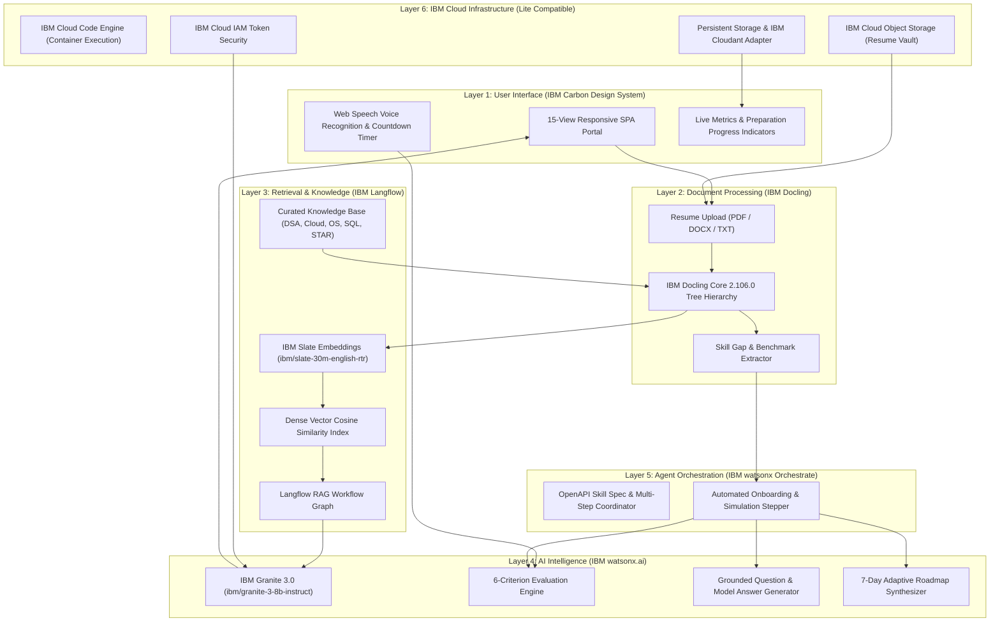

# System Architecture: IBM Granite Interview Trainer Agent

## End-to-End Enterprise Architecture & Technology Stack

The application is structured into six clean, decoupled architectural layers utilizing exclusively **IBM Cloud** technologies and open enterprise standards.

---

### Architectural Diagram

---

### Layer-by-Layer Architectural Specifications

#### Layer 1: User Interface & Experience
- **Framework:** Vanilla JavaScript SPA with zero external heavy bundle overhead, ensuring lightning-fast load times (<50ms).
- **Design System:** Strictly aligned with the **IBM Carbon Design System**:
  - Palette: IBM Blue (`#0f62fe`), Interactive Hover (`#0043ce`), Cool Grays (`#f4f4f4`), Carbon Dark Header (`#161616`).
  - Typography: IBM Plex Sans typography hierarchy.
  - Controls: Accessible form inputs, carbon tiles, data tables, status badges, and progress meters.
- **Interactive Audio:** Native Web Speech API integration (`SpeechRecognition`) enabling voice-to-text answer submission for authentic vocal simulation.

#### Layer 2: Document Processing (IBM Docling)
- **Library:** `docling-core` 2.106.0.
- **Capabilities:**
  - Converts unstructured PDF, DOCX, and text resumes into an official hierarchical `DoclingDocument` object.
  - Automatically identifies section headers, list items, paragraphs, and metadata.
  - Matches candidate text against a comprehensive technical skill taxonomy (Programming, Cloud, Databases, Web, AI, Software Engineering).
  - Performs gap analysis against target role prerequisites (e.g. Cloud Application Developer vs. AI/RAG Engineer).
  - Calculates candidate profile readiness score (0–100) and exports structured Markdown and JSON representations.

#### Layer 3: Retrieval-Augmented Generation (IBM Langflow & IBM Slate)
- **RAG Orchestrator:** IBM Langflow pipeline schema (`orchestration/langflow_rag_pipeline.json`).
- **Dense Vector Embeddings:** `ibm/slate-30m-english-rtr` (384-dimensional dense semantic vectors via watsonx.ai).
- **Knowledge Base:** Curated, authoritative enterprise documentation covering:
  - Technical: Python, Java, C++, DSA, DBMS, OS, Computer Networks, Microservices, Cloud Native.
  - HR & Behavioral: STAR framework (Situation, Task, Action, Result), Present-Past-Future model.
  - Company-Specific: IBM engineering culture, watsonx ecosystem, Red Hat OpenShift hybrid cloud, ethical AI.
- **Grounding Guarantee:** All context sent to IBM Granite includes verifiable source attributions to eliminate factual hallucinations.

#### Layer 4: Foundation Model Intelligence (IBM Granite & watsonx.ai)
- **Primary Model:** `ibm/granite-3-8b-instruct` (Granite 3.0).
- **Alternative Models Supported:** `ibm/granite-13b-chat-v2`, `ibm/granite-20b-multilingual`, `ibm/granite-34b-code-instruct`.
- **Inference Client:** Official `ibm-watsonx-ai` Python SDK with IAM bearer authentication.
- **Evaluation Criteria (6 Core Metrics):**
  1. Technical Correctness (1–10)
  2. Relevance (1–10)
  3. Clarity (1–10)
  4. Communication (1–10)
  5. Completeness (1–10)
  6. Problem-Solving Approach (1–10)

#### Layer 5: Agent Orchestration (IBM watsonx Orchestrate)
- **Skill Specification:** OpenAPI 3.0 specification (`orchestration/orchestrate_skill_spec.json`).
- **Workflows:**
  - Candidate Onboarding Flow: Resume Parsing -> Skill Extraction -> Gap Detection -> Profile Calibration.
  - Mock Simulation Flow: Stepper Session Creation -> Timed Question Delivery -> Answer Submission -> Multi-Metric Evaluation -> Dashboard Updating.

#### Layer 6: IBM Cloud Infrastructure (Lite Compatible)
- **Application Hosting:** IBM Cloud Code Engine (serverless container execution) or Red Hat OpenShift.
- **Containerization:** Red Hat Universal Base Image (UBI 9) / Python 3.10 with non-root security.
- **Object Storage:** IBM Cloud Object Storage (COS) via `ibm_boto3` SDK with secure local partition fallback.
- **Database:** Persistent storage with IBM Cloudant adapter interface.

---

### Security & Responsible AI Governance

1. **Candidate Privacy:** Uploaded resumes are protected within private buckets and local partitions. Sensitive contact PII (phones, physical addresses) is redacted.
2. **Credential Segregation:** All IBM Cloud API keys and Project GUIDs are strictly maintained in `.env` or system environment variables, never committed to git or exposed to the client browser.
3. **Prompt Injection Guardrails:** User inputs are sanitized and wrapped in structured system boundaries before foundation model inference.
4. **Transparent AI Notice:** Every evaluation explicitly includes the IBM SkillsBuild Responsible AI disclaimer stating that AI scores are for coaching and self-assessment, not hiring guarantees.
